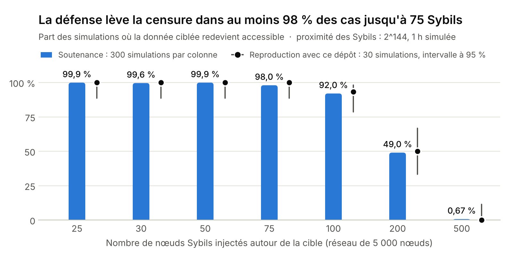
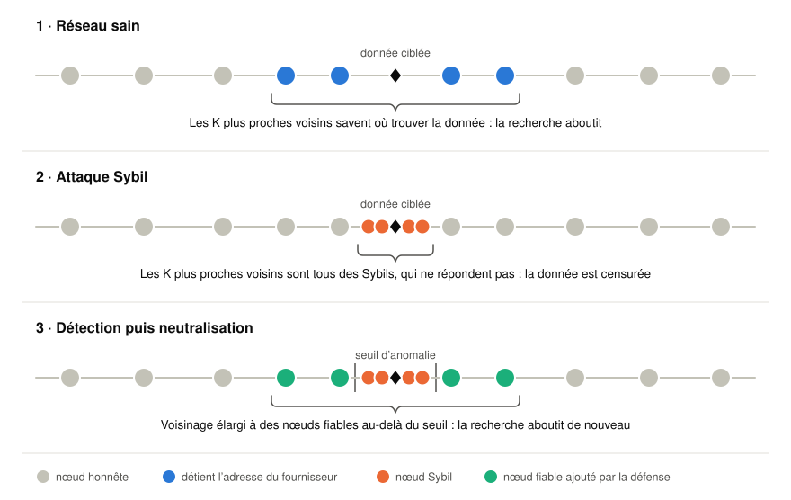
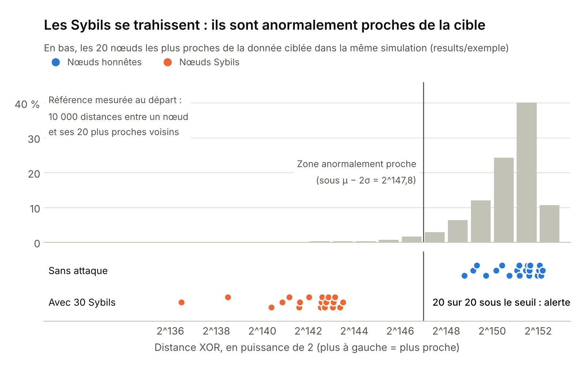
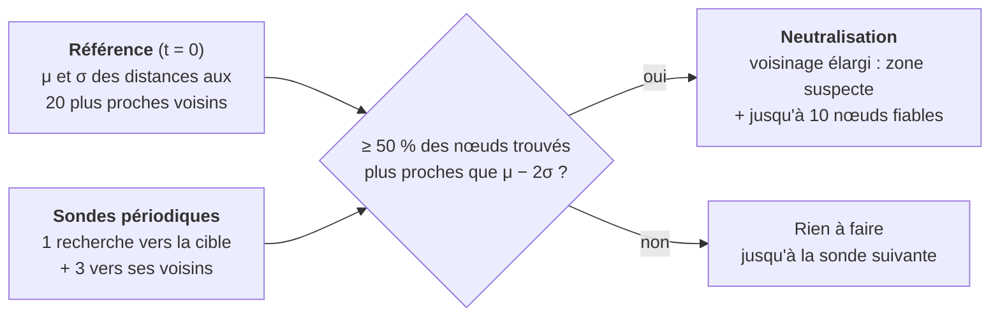
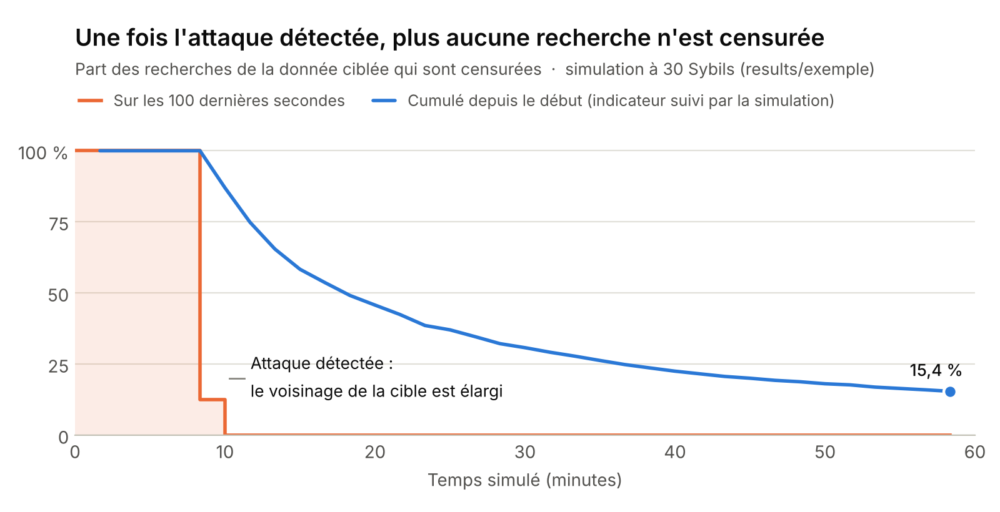
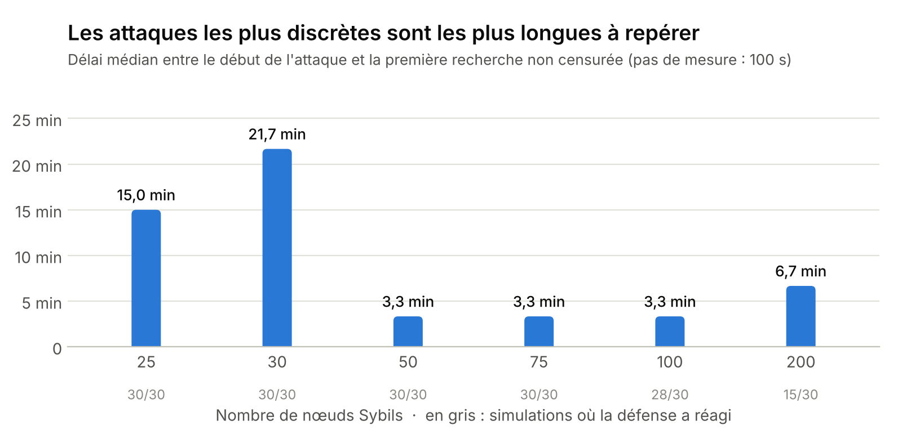

# Défense d'un réseau Kademlia contre une attaque Sybil

   

Dans un réseau pair-à-pair Kademlia, quelques dizaines de faux nœuds bien placés suffisent à rendre une donnée introuvable. Ce projet simule cette **attaque de censure** sur un réseau de 5 000 nœuds, puis lui oppose une défense en deux temps : une **détection statistique** des identifiants anormalement proches de la cible, et une **neutralisation** qui élargit le voisinage consulté.

> **In short (EN).** A PeerSim simulation of a Sybil censorship (eclipse) attack on a 5,000-node Kademlia DHT, with a two-step countermeasure: nodes flag an attack when too many of the peers closest to a key are *abnormally* close (below μ − 2σ of a reference distance distribution), then widen the set of peers holding the record. With 30 Sybils the attack censors 100 % of lookups for the targeted key; the defence restores access in 99.6 % of 300 simulated runs. Java (simulation), Python (batch runs, statistics, figures).

<picture>
  <source media="(prefers-color-scheme: dark)" srcset="docs/figures/taux-reussite-sombre.png">
  
</picture>

Projet de TIPE (2025-2026), présenté sous le titre « Protéger un réseau pair-à-pair d'une attaque de censure » — [diaporama de la soutenance](docs/presentation-tipe.pdf).

## Sommaire

- [Le problème](#le-problème)
- [La méthode](#la-méthode)
- [Résultats](#résultats)
- [Limites et pistes](#limites-et-pistes)
- [Reproduire les résultats](#reproduire-les-résultats)
- [Organisation du dépôt](#organisation-du-dépôt)
- [Crédits et licence](#crédits-et-licence)

## Le problème

Kademlia est la table de hachage distribuée utilisée notamment par BitTorrent et IPFS. Chaque nœud et chaque donnée y reçoit un identifiant (160 bits dans cette simulation), et la « distance » entre deux identifiants est leur **XOR**. Pour publier une donnée, son fournisseur confie son adresse aux **K nœuds les plus proches** de l'identifiant de la donnée (K = 20 ici) ; pour la retrouver, on interroge ces mêmes nœuds.

C'est aussi le point faible du protocole : un attaquant qui crée assez de faux nœuds (**Sybils**) avec des identifiants choisis tout près de celui d'une donnée occupe à lui seul les K places. Il lui suffit alors de ne pas répondre pour que la donnée disparaisse du réseau, sans toucher au fournisseur.

<picture>
  <source media="(prefers-color-scheme: dark)" srcset="docs/figures/schema-attaque-defense-sombre.svg">
  
</picture>

L'espace des identifiants est représenté ici comme une droite pour la lisibilité ; la distance réelle est le XOR.

## La méthode

### 1. L'attaque

`CustomDistribution` désigne au hasard `sybil_count` nœuds du réseau comme Sybils et leur attribue un identifiant à moins de 2^144 de la cible (`proximity_bits`), alors que dans un réseau de 5 000 nœuds les voisins honnêtes d'un identifiant se trouvent autour de 2^151. Un cinquième du trafic simulé recherche la donnée ciblée ; une recherche est comptée comme **censurée** quand tous les nœuds qui détiennent l'adresse du fournisseur sont des Sybils.

Tant que la défense n'a pas réagi, 25 Sybils (à peine plus que K) suffisent à censurer 100 % des recherches.

### 2. La détection par densité

Des identifiants tirés au hasard sont répartis uniformément : la distance entre un nœud et ses plus proches voisins suit une loi connue, que l'on peut mesurer. Des Sybils massés autour d'une cible créent au contraire une zone anormalement dense.

<picture>
  <source media="(prefers-color-scheme: dark)" srcset="docs/figures/detection-densite-sombre.png">
  
</picture>

1. **Référence.** Au début de la simulation, `BaselineInitializer` relève les distances entre 500 nœuds et leurs 20 plus proches voisins, puis en retient la moyenne μ et l'écart-type σ (en nombre de bits de la distance).
2. **Sondes périodiques.** Toutes les 25 requêtes, un nœud pris au hasard sonde le voisinage de la donnée surveillée : une recherche vers la cible puis, au tour suivant, trois recherches vers des nœuds trouvés par la première. Ces recherches supplémentaires explorent les abords de la cible ; sans elles, on ne ramènerait que les Sybils et aucun candidat fiable pour la suite.
3. **Verdict.** `SybilAnomalyDetector` compte, parmi les nœuds trouvés les plus proches de la cible, ceux dont la distance est inférieure à **μ − 2σ**. Au-delà de **50 %**, l'attaque est déclarée.

### 3. La neutralisation

Quand l'attaque est déclarée, `KademliaProtocol.applyMitigation` élargit l'ensemble des nœuds qui détiennent l'adresse du fournisseur :

- **filtre A** : tous les nœuds trouvés dans la zone anormalement proche — on ne cherche pas à distinguer les Sybils des rares nœuds honnêtes qui s'y trouvent ;
- **filtre B** : jusqu'à 10 nœuds de la zone normale, en commençant par les plus proches de la cible.

Il suffit qu'un seul nœud honnête figure dans cet ensemble pour que la censure échoue. Un faux positif ne coûte donc que quelques copies supplémentaires de l'adresse.



## Résultats

### Une simulation en détail

<picture>
  <source media="(prefers-color-scheme: dark)" srcset="docs/figures/exemple-censure-sombre.png">
  
</picture>

Dans cette simulation ([`results/exemple`](results/exemple)), les 30 Sybils censurent d'abord toutes les recherches de la donnée, 140 au total. L'attaque est détectée entre la 8ᵉ et la 10ᵉ minute ; en deux détections, l'ensemble des détenteurs de l'adresse passe de 20 à 47 nœuds, et plus aucune des 746 recherches lancées après la 10ᵉ minute n'est censurée.

### Sur 300 simulations par configuration

Une défense est comptée comme réussie si la donnée redevient accessible avant la fin de l'heure simulée (censure finale inférieure à 100 %).

| Nombre de Sybils | 25 | 30 | 50 | 75 | 100 | 200 | 500 |
|---|---|---|---|---|---|---|---|
| Défenses réussies — soutenance, 300 simulations | 99,9 % | 99,6 % | 99,9 % | 98,0 % | 92,0 % | 49,0 % | 0,67 % |
| Défenses réussies — reproduction, 30 simulations | 100 % | 100 % | 100 % | 100 % | 93,3 % | 50,0 % | 0 % |

Paramètres : 5 000 nœuds, K = 20, Sybils à moins de 2^144 de la cible, 1 h simulée, environ 100 tests de détection par heure, renouvellement continu des nœuds (*churn*). La seconde ligne a été recalculée à partir du code de ce dépôt ([`results/balayage_sybils.csv`](results/balayage_sybils.csv), graines 1000 à 1209).

<picture>
  <source media="(prefers-color-scheme: dark)" srcset="docs/figures/delai-reaction-sombre.png">
  
</picture>

Avec 25 à 30 Sybils, la part de nœuds anormaux relevée par une sonde oscille autour du seuil de 50 % : il faut souvent plusieurs tests avant que l'alerte se déclenche, d'où un délai médian de 15 à 22 minutes. Dès 50 Sybils, l'attaque est repérée en quelques minutes.

## Limites et pistes

- **Attaques massives.** À partir de 200 Sybils, la défense échoue une fois sur deux. Ce n'est pas la détection qui cède : dans le balayage, toutes les simulations en échec ont déclenché l'alerte au moins une fois. C'est la neutralisation qui ne trouve plus assez de nœuds honnêtes autour de la cible. Le compromis est assumé : la force d'une attaque Sybil est son faible coût, et c'est contre les attaques à quelques dizaines de nœuds que la défense est efficace.
- **Référence centralisée.** La distribution de référence est calculée par une entité qui voit tout le réseau, ce qu'aucun nœud réel ne peut faire. Une estimation locale et continue, par échantillonnage des recherches ordinaires, serait plus réaliste.
- **Modèle de censure simplifié.** La simulation ne stocke pas réellement la donnée : elle suit l'ensemble des nœuds censés détenir l'adresse du fournisseur et considère qu'un seul détenteur honnête suffit.
- **Pistes.** Défense hybride combinant densité et réputation des nœuds ; tenue face à un grand nombre de Sybils.

## Reproduire les résultats

Prérequis : un JDK (8 ou plus) et Python 3.9 ou plus.

```bash
git clone https://github.com/paulin-guillet/Defense-Reseau-Kademlia.git
cd Defense-Reseau-Kademlia
pip install -r requirements.txt        # matplotlib et numpy, pour les figures uniquement
```

Les scripts compilent le code Java dans `build/` au premier lancement et fonctionnent à l'identique sous Windows, Linux et macOS.

```bash
# Une simulation (environ 15 s), avec export des CSV détaillés
python scripts/simuler.py --runs 1 --sybils 30 --graine 1 --sortie results/exemple

# Une série : 300 simulations à 30 Sybils, 4 en parallèle
python scripts/simuler.py --runs 300 --sybils 30 --jobs 4

# Le balayage de ce README
python scripts/simuler.py --runs 30 --sybils 25 30 50 75 100 200 500 --proximite 144 --graine 1000 --jobs 2 --csv results/balayage_sybils.csv

# Les figures du README, puis les graphiques d'analyse d'une simulation
python scripts/figures_readme.py
python scripts/graphe.py results/exemple
```

Pour lancer PeerSim directement, une fois le code compilé (remplacer `:` par `;` sous Windows) :

```bash
java -cp "build/classes:peersim/*" peersim.Simulator kademlia/example.cfg
```

### Paramètres principaux (`kademlia/example.cfg`)

| Paramètre | Valeur | Rôle |
|---|---|---|
| `SIZE` | 5000 | Nombre de nœuds |
| `K` | 20 | Taille des k-buckets et nombre de détenteurs d'une adresse |
| `SIM_TIME` | 1 h | Durée simulée |
| `init.1uniqueNodeID.sybil_count` | 30 | Nombre de Sybils |
| `init.1uniqueNodeID.sybil_target` | — | Identifiant de la donnée attaquée |
| `init.1uniqueNodeID.proximity_bits` | 144 | Les Sybils sont à moins de 2^144 de la cible |
| `control.0baseline.sample_size` | 500 | Nœuds échantillonnés pour la référence |
| `control.1traffic.detection_period` | 25 | Une sonde de détection toutes les 25 requêtes |
| `control.2turbolenceAdd.p_add` / `p_rem` | 0,5 / 0,5 | Arrivées et départs de nœuds (*churn*) |

`positif.cfg` (50 Sybils, sans *churn*) et `negatif.cfg` (témoin sans Sybil) sont deux variantes prêtes à l'emploi. Tout paramètre peut aussi être passé en ligne de commande, après le fichier de configuration.

## Organisation du dépôt

```
kademlia/                 Le cœur du projet
  src/peersim/kademlia/     protocole Kademlia, attaque, détection, neutralisation (Java)
  example.cfg               configuration principale
scripts/
  simuler.py                compile, lance des séries de simulations, calcule le taux de réussite
  figures_readme.py         figures de ce README
  graphe.py                 graphiques d'analyse détaillés d'une simulation
results/
  exemple/                  exports CSV d'une simulation complète
  balayage_sybils.csv       une ligne par simulation du balayage
docs/                     diaporama de la soutenance et figures
peersim/                  simulateur PeerSim 1.0.5 (dépendance tierce, non modifiée)
```

| Classe | Rôle | Origine |
|---|---|---|
| `CustomDistribution` | Attribue les identifiants et place les Sybils près de la cible | modifiée |
| `BaselineInitializer` | Mesure la distribution de référence des distances | ajoutée |
| `TrafficGenerator` | Génère le trafic, les recherches ciblées et les sondes de détection | modifiée |
| `SybilAnomalyDetector` | Compte les nœuds anormalement proches et rend le verdict | ajoutée |
| `KademliaProtocol` | Protocole Kademlia ; mesure la censure et applique la neutralisation | modifiée |
| `KademliaObserver` | Collecte les statistiques et exporte les CSV | modifiée |

## Crédits et licence

- **Attaque Sybil, détection et neutralisation** : Paulin Guillet, dans le cadre du TIPE.
- **Kademlia pour PeerSim** : Daniele Furlan et Maurizio Bonani (licence LGPL 2.1), dont ce projet modifie et étend le code.
- **PeerSim** : Alberto Montresor, Márk Jelasity et contributeurs (licence LGPL) ; bibliothèque JEP de Singular Systems (licence GPL).

Le code de ce dépôt est distribué sous licence [LGPL 2.1](LICENSE), comme le module Kademlia dont il dérive.
